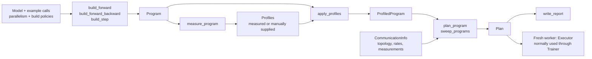

# Architecture overview

ShadowSpill compiles fixed-shape PyTorch work, measures its costs, and plans how
its tensors fit in bounded device and spill memory. The runtime executes that
saved plan repeatedly. PyTorch and kernel providers do the numerical work;
ShadowSpill controls tensor residency, movement, readiness and safe memory reuse.

## Public phases

Preparation and execution have explicit boundaries. Quickstart composes these
APIs; applications can call each phase independently.

| Phase | Responsibility | Environment |
|---|---|---|
| Build | Capture, partition, differentiate, finalize implementations, and lower graph/storage structure. Preserve save/recompute alternatives and semantic source names. | PyTorch; a representative GPU when compilation or provider selection requires it. No execution pools. |
| Measure | Record task timing, unresolved memory requirements and allocation behavior without changing task definitions. | GPU with the ordinary allocator and bounded allocation observation. No execution pools. |
| Apply profiles | Validate coverage and compatibility; snapshot supplied costs and memory evidence. | CPU, without PyTorch or runtime setup. |
| `measure_communication` | Optionally calibrate host copies and collectives independently of task measurement. | GPU; real process groups for collective probes. |
| Plan/search | Choose traversal, optimizer ordering, task alternatives, residency and transfers under memory/communication constraints. Simulate and, when evidence permits, assign physical ranges. | CPU, without PyTorch or execution pools. |
| Execute | Bind workers/resources, install the allocator, initialize bounded tensor chunks and dispatch the saved schedule. | Fresh GPU worker; real process groups for distributed plans. |

Ordinary DP compute tasks can be built and measured on one representative GPU
without a process group. Communication costs come from `CommunicationInfo`:
compatible measurements take precedence over estimates from rates and topology.
Model-owned distributed operations may require their own group-aware preparation.

See [the phase APIs](offline-pipeline.md) for signatures, examples, supported
parallelism and current limitations.

## Artifacts, costs and execution

| Public artifact | Contents |
|---|---|
| `Program` | One concrete call/step candidate: fixed input signatures, task code, dependencies, tensor/storage geometry, implementation identities and alternatives. No task durations. |
| `Profiles` | Editable numeric task records for one hardware/runtime setup, including timings and missing/dynamic memory evidence. |
| `ProfiledProgram` | A Program plus a validated snapshot of its applied profiles. |
| `Plan` | Selected work, schedule, timeline, physical layout when available, diagnostics, code and worker/input contracts. |
| `SweepResult` | Each candidate/budget result and the best Plan per budget. |

Artifacts have explicit save/load using a single archive. `ProfiledProgram` and
`Plan` include their required upstream artifacts; they do not depend on old cache
directories. Compiler caches are optional acceleration, separate from artifacts.
Checkpoint values and compatible runtime/provider libraries remain external.

Manually estimated durations can inform planning. Estimated memory is
**simulation-only**: it never authorizes execution. Unknown memory is not zero.
Executable Plans need validated allocation evidence, compatible implementations,
and physical admission. `MemoryBudgets.execution_bytes` includes runtime/provider
headroom as well as usable execution memory; spill capacity is separate.

Every rank loads a Plan for its declared parallelism: one saved Plan on one kind
of GPU, or Plans built for each GPU that agree on what the ranks exchange and in
what order, each with its own microbatch geometry. Executor applies a complete
worker-to-logical-rank mapping and recreates process-local resources. A saved
Plan is not portable across arbitrary world sizes, architectures or dependency
builds.

`Executor.run()` returns a result handle; `.result()` waits and returns
caller-owned outputs. One invocation is active at a time per Executor. The next
`run()` waits for the previous one. Trainer handles the training loop using this
same interface, optionally with a separately built evaluation Plan sharing model
tensors. Build, measurement and planning remain outside Trainer and Executor.

## Source organization

The top-level `shadowspill` package exposes the small public API lazily. CPU
artifact inspection, profile application, planning and reporting do not import
PyTorch or install the execution allocator.

| Python directory | Responsibility |
|---|---|
| `artifacts/` | Public artifacts, validation, archive encoding and tensor/task descriptions. |
| `build/` | Public builders, capture composition, compilation and lowering. |
| `profiling/` | GPU task measurement and CPU profile application. |
| `parallelism/` | Logical groups, parameter/input placement and storage declarations. |
| `resources/` | Generic provider descriptions, checked initialization and lifecycle. |
| `communication/` | Communication costs, calibration and worker group binding. |
| `planning/` | Public planning/sweeps, ordering, cost assembly and admission inputs. |
| `execution/` | Saved-plan setup, storage, bounded initialization/export and dispatch. |
| `training/`, `checkpoint/` | Trainer, schedules and checkpoint helpers above Executor. |
| `reporting/` | CPU reports from saved planning results. |
| `pytorch/` | PyTorch capture, AOT graph pairs, storage contracts, kernel choices, saved-code restoration and runtime adapters. |
| `ir/`, `planner/`, `simulator/`, `runtime/` | Framework-neutral IR and native-library interfaces. |

Recipes, quickstart and qualification runners compose the same public phases.
Low-level IR and runtime APIs support tooling; they do not provide a separate
model-preparation path.

## Planning and memory ownership

The public `Program` packages task definitions and executable metadata around the
framework-neutral IR. Planning supplies costs and policy inputs to the native
search/simulator. The lower-level `ShadowSpillProgram` and planning-problem types
are internal representations, not additional preparation steps for users.

| Component | Question answered |
|---|---|
| Stage partitioning | Where should captured computation be divided? |
| Graph-pair construction | Which forward/backward save/recompute alternatives are legal? |
| Planning/search | Which alternatives, traversal, updates and residency policy fit and perform best? |
| Simulator | What compute/transfer/dependency timeline does that policy imply? |
| Physical admission | Can allocations occupy real ranges without exceeding capacity or reusing live memory? |
| Executor/runtime | How are admitted records bound and executed on this worker? |

A tensor's semantic identity comes from its source and storage/view relationships,
not its current address. Lowering keeps one canonical object across tasks;
planning determines its residency and physical ranges. Execution binds current
lease generations and publishes new ones after writes.

Compute, gradient-reduction and optimizer-publication tasks currently retain
ordered completion on the compute resource. Host fetch/evict transfers use the
runtime's tracked lanes and readiness events. Arbitrary independent task lanes
with concurrent readers are not qualified by this distributed path.

The following invariants apply throughout:

- Physical ranges are reused only after stream order or explicit completion
  dependencies make prior accesses complete.
- Fetch/evict destinations consume capacity when reserved, including queue time.
- A task's completion covers all provider work affecting its outputs; a provider
  must join private work before publishing completion.
- Saved allocation contracts bound admitted work. An unexpected allocation fails
  explicitly rather than silently escaping the budget.
- Transfer, lease and object generations prevent stale completion from modifying
  a successor.

## Native libraries

| Library | Responsibility |
|---|---|
| `libshadowspill.so` | Neutral IR, simulation, search, admission and runtime: pools, leases, actions, events and transfer progress. |
| `libshadowspill_backend_<provider>.so` | Driver allocation/registration, streams, copies, events and device statistics. |
| `libshadowspill_pytorch.so` | PyTorch allocator and storage adapter; loads the backend and optional extensions. |
| `libshadowspill_network.so`, `libshadowspill_ssd.so` | Optional remote-memory and SSD pools/routes. |

The neutral runtime is handed backend, pool and lane contracts; it does not load
provider libraries or interpret model semantics. The PyTorch adapter binds those
contracts. A Python dispatcher launches compiled tasks, while the native worker
progresses eligible transfers and publishes completion.

At each task boundary, `before_task()` acquires storage and inserts readiness and
reuse waits. The task enqueues numerical work. `after_task()` publishes outputs,
mutations, completion fences and eligible memory actions. Transfers use stream
waits where possible rather than blocking the dispatcher until bytes arrive.

## Further reading

Start with [the public phase APIs](offline-pipeline.md), then follow the relevant
implementation boundary:

- [IR](ir.md), [capture and lowering](lowering.md),
  [graph-pair construction](graph-pair-construction.md).
- [Search](search.md), [simulation](simulation.md),
  [physical admission](physical-admission.md).
- [Task boundaries](task-boundaries.md), [memory pools](memory-pools.md),
  [transfers](transfers.md), [backends](backends.md), [PyTorch adapter](adapter.md).

The [documentation index](../README.md) links the remaining implementation pages.
