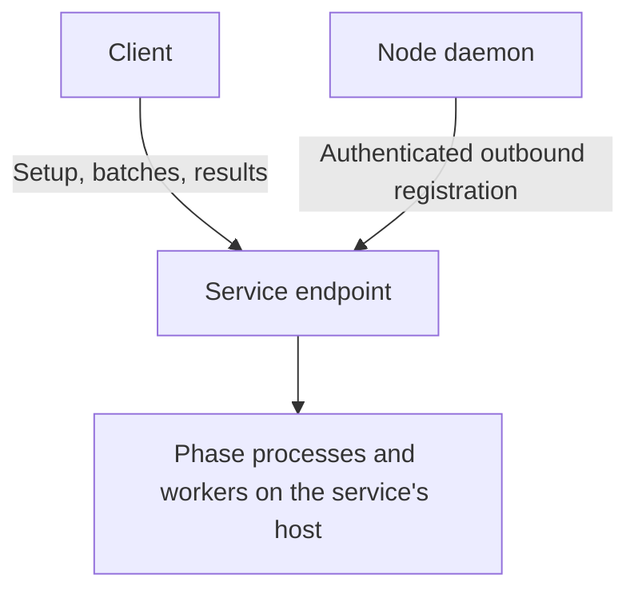

# Service and node daemons

One service endpoint coordinates the compute assigned to it. A client connects
to that endpoint, selects training settings and submits global batches. Process
launch and physical worker placement belong to the service.

A training run uses the devices of the service's own host: a local machine or a
single-node Slurm step, as described in [Advanced
deployment](../../python/advanced/deployment.md). Node daemons register further
machines with the service. Their hardware appears in its inventory, and no run
is placed on them.

## Component responsibilities

| Component | Responsibility |
| --- | --- |
| Client | Own data, inspect hardware/Plans, submit training commands and read results |
| Service | Authenticate clients/nodes, maintain inventory, select devices on its own host, coordinate preparation and own ordered runs and durable outcomes |
| Node daemon | Register an operator-assigned machine, keep its membership alive, and reserve or release its local resources on command |
| Worker | Run build/profile/plan phases or the Executor using its assigned logical rank |

On its own host the service applies `NodeAdmission`, the same admission a node
daemon wraps, directly. Installed models and objectives, packing and optimizer
semantics stay with their owners; a node daemon has no training state machine.

## Discovery begins at the node

The operator gives a node daemon the service URL, a node credential and its assigned
resources. The node daemon registers with that service. The service learns hardware
and connection state from this registration and subsequent heartbeats. It does
not need a hostname list, network scan or SSH access to discover members.

The service decides which identities may join and which compute pools they may
enter. The node daemon reports only resources supplied by its operator or scheduler.
SSH, a shell, a service manager or a Slurm step can start the same node daemon; none
changes the joining protocol or requests new capacity.

See [registration and control](nodes.md) for the join algorithm and message
contract, and [assignments and recovery](execution.md) for resource claims,
worker readiness and failure handling.

## Three kinds of traffic

Node control messages carry membership and resource commands. Admitted artifact
streams carry Plans, inputs, results and logs between client and service.
Worker collectives exchange model state directly between a run's workers;
neither the client nor the service relays them. A node daemon registers through
an outbound HTTPS connection, so it can reach the service across the Internet or
NAT.

## Source ownership

| Package | Owns |
| --- | --- |
| `server/` | Public/internal authenticated routes, controller composition, durable records and artifact access |
| `orchestration/nodes/` | Hardware selection, membership, node daemon connections and generic node coordination |
| `orchestration/launch/` | Assigned-resource admission, file staging and owned process supervision |
| `training/preparation/` | Target-specific phase work and compatible Plan families |
| `training/session/` | Ordered training commands and optimizer/accumulation state |
| `training/worker/` | Training envelopes, rank bindings and Executor ownership |

---

Previous: [Training composition](../training.md) ·
[Architecture index](../README.md) ·
Next: [Node registration and control](nodes.md)
