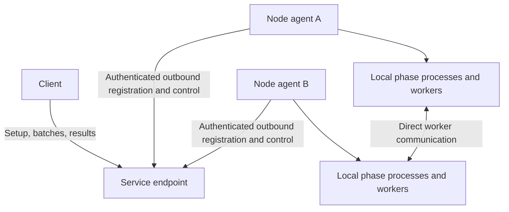

# Service and node agents

One service endpoint coordinates the compute assigned to it. A client connects
to that endpoint, selects training settings and submits global batches. Node
addresses, process launch and physical worker placement belong to the service.

This section specifies the node-agent architecture. Remote registration and
per-worker setup are being implemented; the runnable deployment API is described
in [Advanced deployment](../../python/advanced/deployment.md).

## Component responsibilities

| Component | Responsibility |
| --- | --- |
| Client | Own data, inspect hardware/Plans, submit training commands and read results |
| Service | Authenticate clients/nodes, maintain inventory, select resources, coordinate preparation and own ordered runs and durable outcomes |
| Node agent | Offer assigned capacity, claim local resources, stage artifacts, supervise owned processes and confirm cleanup |
| Worker | Run existing build/profile/plan phases or the Executor using its assigned logical rank |

The controller needs no GPU. An embedded local agent provides the same ownership
and admission rules for a local deployment. Independent agents use the remote
protocol. Model definitions, objectives, packing and optimizer semantics stay in
their existing owners; an agent has no second training state machine.

## Discovery begins at the node

The operator gives an agent the service URL, a node credential and its assigned
resources. The agent registers with that service. The service learns hardware
and connection state from this registration and subsequent heartbeats. It does
not need a hostname list, network scan or SSH access to discover members.

The service decides which identities may join and which compute pools they may
enter. The agent reports only resources supplied by its operator or scheduler.
SSH, a shell, a service manager or a Slurm step can start the same agent; none
changes the joining protocol or requests new capacity.

See [registration and control](nodes.md) for the join algorithm and message
contract, and [assignments and recovery](execution.md) for resource claims,
worker readiness and failure handling.

## Three kinds of traffic

Control messages carry membership, assignments and existing worker envelopes.
Admitted artifact streams carry Plans, inputs, results and logs. Worker
collectives exchange model state directly between participating workers.
Neither the laptop nor the service relays these collectives.

An agent can register through an outbound HTTPS connection across the Internet
or NAT. A distributed run additionally needs worker-to-worker rendezvous and
collective reachability, normally through a private routed network or VPN.
Registration success alone does not establish this. The chosen worker interfaces
must be tested before expensive distributed preparation; communication libraries
can fail or hang on an interface that is up but cannot reach peers.
See [NCCL's networking guidance](https://docs.nvidia.com/deeplearning/nccl/user-guide/docs/troubleshooting/networking_troubleshooting.html).

## Source ownership

| Package | Owns |
| --- | --- |
| `server/` | Public/internal authenticated routes, controller composition, durable records and artifact access |
| `orchestration/nodes/` | Hardware selection, membership, agent connections and generic node coordination |
| `orchestration/launch/` | Assigned-resource admission, file staging and owned process supervision |
| `training/preparation/` | Target-specific phase work and compatible Plan families |
| `training/session/` | Ordered training commands and optimizer/accumulation state |
| `training/worker/` | Training envelopes, rank bindings and Executor ownership |

The laptop SDK remains lightweight. The existing phase engine and generic
parallelism interfaces remain the execution foundation. Optional launch backends
can use the node boundary without changing `step()`, `forward_backward()`,
`optim_step()` or `forward()`.

---

Previous: [Training composition](../training.md) ·
[Architecture index](../README.md) ·
Next: [Node registration and control](nodes.md)
