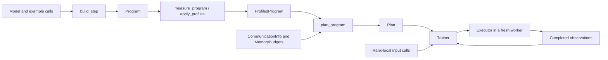

# Training composition

Preparation produces saved phase artifacts; training consumes a Plan. Models,
objectives, data packing and qualification thresholds stay outside the installed
trainer. See the [phase API](offline-pipeline.md) for the full artifact contracts.

## Responsibilities

| Component | Owns |
| --- | --- |
| Model and objective | Forward math, differentiable loss, optional tensor outputs |
| Builders | Capture, operator recomputation, stage partitioning, finalized task implementations and static storage |
| Profiling | Task durations and missing memory evidence, using the ordinary allocator |
| Planning | Example/optimizer ordering, save/recompute selection, transfers and physical admission |
| Executor | Allocator/pools, groups, saved task execution and bounded tensor access |
| Trainer | Update count, schedules, host observations, optional fit loop and checkpoint progress |
| Caller data source | Per-example args/kwargs and optional progress serialization |
| Logger/callbacks | CPU metrics, evaluation cadence and application-specific actions |
| Workload recipes | Model configuration, initialization/checkpoint mapping, tokenizer and data semantics |

`Trainer(plan, ...)` performs no build, profiling or planning. Direct callers can
use Executor without a Trainer, or supply an existing Executor to Trainer.
Quickstart and recipes compose the same phases in separate workers. An ordinary
PyTorch reference loop remains an independent workload implementation.

## State and lifetime

Executor installs its allocator before device initialization, binds the saved
logical groups and admits the selected memory layout. `initialize(fill_tensor)`
asks the caller to fill bounded buffers for declared tensor shards. A saved Plan
contains computation and initialization contracts, not checkpoint weights.

A separately built forward Plan can be passed as `evaluation_plan`. Its model
tensors share training storage; both plans are admitted against one budget before
execution. They run sequentially. Evaluation uses current compute weights and
does not update gradients, optimizer state, schedules or training progress.

Trainer owns an Executor it creates; an externally supplied Executor remains
caller-owned. Returned step observations contain CPU values. Direct Executor
calls return a pending handle; `.result()` waits for caller-owned outputs.

## Data and observations

Each `fit` source item is a mapping of arguments for `Trainer.step`, normally
`{"args": [...], "kwargs": [...]}`. Each sequence entry describes one example
in the saved Program. The plan chooses execution order. Nested model inputs and
static metadata use the builder's ordinary PyTorch argument structure.

The objective supplies its normalization. Contributions accumulate; the trainer
does not infer token counts or replica denominators. Rank-local loss and other
observations remain separate until the caller's CPU metric reducer combines them.

Optional weight/gradient norms are eager observations before optimizer updates,
with bounded, budgeted scratch. They are disabled by default. They do not become
compiled tasks, and their runtime is absent from simulated timelines. Enabled
observations contribute to measured step time. Ordinary callbacks run after the
completed step, outside compiled work.

## Checkpoint and resume

Trainer checkpoint helpers stream Executor tensors and save loop, source,
schedule and RNG progress. Partial LoRA checkpoints require an immutable frozen
base identity and a bounded loader for omitted weights. They retain optimizer
state and masters so training can resume faithfully.

`steps` is the total completed-update target. Schedules are evaluated at the
zero-based update count and name the saved Plan's runtime hyperparameters, such
as `optimizer_group.0.lr`. Data sources can implement `state_dict` and
`load_state_dict` for exact continuation. Resuming loads the same Programs;
compatible budgets and planning order can change independently.

## Distributed execution and reporting

The central `Parallelism` description fixes logical ranks, placements and storage
sharding during build. Ordinary DP compute tasks build and profile without live
process groups. `measure_communication` separately calibrates the declared
collectives. Planning consumes those saved costs and memory evidence.

Fresh workers share a complete worker-to-logical-rank mapping and Plans that
agree on what the ranks exchange, usually one saved Plan.
Compute and optimizer communication retain their ordered execution contract.
Parameter fetch/all-gather and gradient eviction/reduce-scatter use the tracked
transfer paths. Backend work must finish under its task's completion event;
private streams remain the backend's responsibility.

`DistributedLogger` can aggregate completed CPU records asynchronously, retaining
per-rank logs and optional W&B runs. It does not add runtime task barriers.
Workloads may explicitly reduce globally normalized losses after step completion.

See the [training example](../examples/generic-training.md),
[checkpoint lifecycle](../python/api/training.md#checkpoints),
[quickstart](../../benchmarking/quickstart.md), and
[text recipes](../../workloads/README.md).
