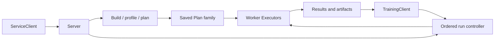

# Training composition

The client connects to one service endpoint, prepares a model and submits global
batches. Preparation and worker startup are separate from the live training
commands. Both use the build/profile/plan/Executor engine.

## Responsibilities

| Component | Owns |
| --- | --- |
| Client application | Data, per-call learning rates, evaluation cadence and result display |
| `ServiceClient` | Connection, preparation requests, saved Plans and run attachment |
| `TrainingClient` | Owned input snapshots, local batch validation and asynchronous commands |
| Catalog components | Model math, objective semantics, initialization and input adapters |
| Preparation | Resolve components, build candidates, profile and plan, admit the saved family |
| Run controller | Request ordering, accumulation state, completed updates and worker coordination |
| Worker Executor | Saved task execution, shared model state, memory pools and bounded tensor access |
| Service storage | Durable request outcomes, checkpoint generations, logs and reports |

The optional workloads package supplies built-in components. External packages
use the same registration API. Neither the engine nor the controller imports a
particular model family. Independent PyTorch references remain outside the
production execution path.

## Preparation and startup

Preparation captures candidate computations, measures their costs and constructs
compatible Plans within the requested memory budgets. Homogeneous workers share
one complete Plan for each selected variant, with rank-specific tensor shards,
inputs and communicator bindings supplied during startup.

`plan_training()` publishes saved Plans and predicted HTML reports before any
training starts. Creating a training client from those Plans skips build,
profiling and planning. Workers validate the saved computation and installed
sources, bind their logical ranks and initialize model state through bounded
loaders. Plans contain computation contracts, not checkpoint weights.

A separately requested `forward()` operation shares model storage with training.
Preparation admits their combined storage before execution. Training does not
implicitly build a forward-only path for batches with no supervised contribution.

## Inputs and operations

The client submits one global batch. `validate_batch()` checks its schema,
packing and compatibility with the prepared layouts locally; the server repeats
authoritative validation before accepting execution. Packing uses declared input
partitions, preserves indivisible groups and restores outputs to caller order.
It cannot add a new microbatch shape or Plan during training.

The token cap counts scheduled padding once per logical input partition. Three
64K buffers exceed a 128K step cap even when their real inputs total less than
128K. Copies sent to cooperating workers do not multiply that logical capacity.
Input placement describes replication or slicing; model operators must implement
the corresponding distributed computation.

| Command | Effect |
| --- | --- |
| `step()` | Compute one batch and apply an optimizer update |
| `forward_backward()` | Add a batch's gradients to the open accumulation |
| `optim_step()` | Apply the accumulated gradients and close that accumulation |
| `forward()` | Evaluate current model weights without changing training gradients or progress |
| `discard_gradients()` | Close an accumulation without an optimizer update |

The first backward contribution writes fresh gradients; subsequent contributions
accumulate. Participation comes from explicit validity on the original inputs,
before routing and padding. Numeric loss, token weights and final gradient scale
do not determine participation. A globally unsupervised training batch is
rejected; individual masked records and empty worker partitions remain valid
when another part of the batch contributes.

The objective defines its reduction. The engine sums gradient contributions
without an implicit replica or token denominator. Text batch helpers can provide
weights normalized over all supervised tokens in the update. Per-call optimizer
controls, including learning rate, are explicit and do not become sticky defaults.
See [objectives](../python/advanced/objectives.md) for complete examples.

## Completion and persistence

The controller confirms state only after every worker and required terminal
transfer completes. Rejection before execution preserves earlier gradients;
unknown execution effects invalidate live state. A durable execution receipt
precedes output publication, so a failed download or report cannot cause an
optimizer update to run again.

Checkpoint saves, restores and orderly close require a closed accumulation.
Checkpoints contain optimizer progress, registered state, default RNG streams and
caller metadata. Frozen weights may be omitted only with a verified immutable
base dependency. New-run resume can convert compatible logical state for another
Plan layout before workers start; changing optimizer semantics is rejected.
Client data cursors and schedules remain application-owned metadata.

Results contain declared metrics, named objective losses and server execution
time. Predicted reports are available from the prepared Plans. An invocation with
`runtime_trace=True` additionally produces measured HTML timelines, associated
with the exact Plan and worker used. Upload, queueing and client-side data work
are separate from server execution time.

See [basic training](../examples/client-training.md),
[saved Plans](../python/advanced/saved-plans.md),
[service records](service-records.md) and the
[phase API](../python/phases.md).

---

Previous: [Step structure and ordering](step.md) ·
[Architecture index](README.md) ·
Next: [Service and node daemons](service/README.md)
